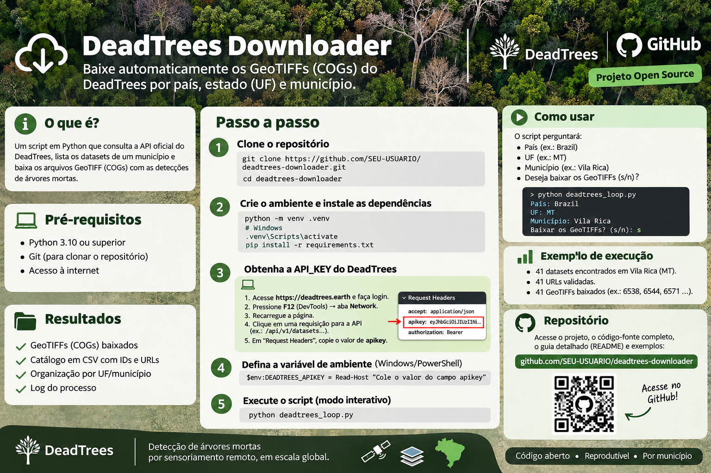

# DeadTrees Downloader — GeoTIFFs (COGs) por município



Cliente **independente**, em Python, para consultar datasets públicos do [DeadTrees](https://deadtrees.earth/) por **país e município**, obter os caminhos COG por meio da API oficial e baixar os arquivos GeoTIFF completos com retomada e validação por tamanho. **Não é um projeto oficial do DeadTrees.**

> **Teste documentado (12/11/2026):** Vila Rica (MT): 41 registros encontrados, 41 caminhos oficiais retornados e 41 URLs validadas. O log fornecido pelo usuário confirma downloads concluídos dos IDs 6538, 6544, 6571 e 6588; os demais estavam em andamento. Isso não comprova que todos os 41 downloads terminaram.

## 1. Pré-requisitos

- Windows PowerShell, Python 3.10+ e acesso à internet.
- Git é opcional: pode-se usar **Code → Download ZIP** no GitHub.
- Espaço em disco suficiente para os arquivos COG, que podem ser grandes.

## 2. Instalar

```powershell
git clone https://github.com/SEU-USUARIO/deadtrees-downloader.git
cd deadtrees-downloader
python -m venv .venv
.\.venv\Scripts\Activate.ps1
python -m pip install -r requirements.txt
```

Se já usa Conda, ative seu ambiente Python e instale apenas `python -m pip install -r requirements.txt`.

## 3. Localizar a chave pública `apikey` pelo F12

1. Acesse https://deadtrees.earth/ no navegador.
2. Pressione **F12** e abra **Network / Rede**.
3. Atualize a página (F5) e filtre por `supabase.deadtrees.earth`.
4. Clique em uma requisição pública `rest/v1/...` e abra **Headers / Cabeçalhos → Request Headers**.
5. Localize o campo **`apikey`**. Use **somente a chave pública de papel `anon`**. Não copie `Authorization: Bearer`, cookies, `access_token`, refresh tokens ou outras credenciais pessoais.
6. Se a chave pública não aparecer, não tente extrair tokens privados. A chave pública pode estar na configuração pública do frontend; respeite as condições de uso do serviço.

No **mesmo terminal** em que executará o programa:

```powershell
$env:DEADTREES_APIKEY = Read-Host 'Cole a chave publica anon (apikey)'
```

**Não inclua a chave no código, em screenshots, issues ou commits.** Nunca publique arquivos HAR sem remover cabeçalhos e credenciais.

## 4. Executar em modo interativo

```powershell
python deadtrees_loop.py
```

Exemplo de perguntas:

```text
País [Brazil]: Brazil
UF (sigla) [MT]: MT
Município: Vila Rica
Baixar os GeoTIFFs agora? [s/N]: s
```

O campo **UF é usado para organizar a saída**, não como filtro geográfico independente no catálogo público. A busca no Supabase usa `admin_level_2` (nome do município) e confere `admin_level_1` (país). Em casos de municípios homônimos, confirme os resultados antes de usar.

## 5. Executar sem perguntas (opcional)

```powershell
python deadtrees_loop.py --pais Brazil --uf MT --municipio 'Vila Rica' --download-cog
python deadtrees_loop.py --pais Brazil --uf PA --municipio Paragominas --download-cog
```

Para testar apenas 2 downloads:

```powershell
python deadtrees_loop.py --pais Brazil --uf MT --municipio 'Vila Rica' --download-cog --max-downloads 2
```

## 6. Arquivos gerados

```text
downloads/
  MT/
    Vila_Rica/
      catalogo_cogs.csv
      6538_cog.tif
      6544_cog.tif
      ...
```

Arquivos parciais usam `.tif.part`; uma nova execução pode retomá-los. O CSV registra IDs, URLs, status e tamanho em bytes. Não remova arquivos `.part` durante a transferência.

## 7. Como funciona

1. Consulta `https://supabase.deadtrees.earth/rest/v1/v2_full_dataset_view_public` com a chave pública `anon`.
2. Para cada ID público, consulta `GET https://data2.deadtrees.earth/api/v1/datasets/{id}/files/cog`.
3. Lê o `cog_path` devolvido e forma a URL pública de COG em `https://data2.deadtrees.earth/cogs/v1/`.
4. Valida a resposta GeoTIFF por requisição HTTP Range e assinatura TIFF.
5. Baixa em blocos de 4 MiB, com novas tentativas e retomada. Preserva os arquivos completos na resolução disponibilizada pela fonte.

**Limites de uso:** a API pode responder HTTP 429; o script interrompe novas consultas nesse caso. Não tente contornar quotas ou controles de acesso. HTTP 404 pode indicar dataset não público ou indisponível. Dados e licenças são definidos pelo DeadTrees e pelos autores de cada dataset; verifique atribuição, termos e permissões antes de redistribuir imagens.

## 8. Problemas comuns

- `DEADTREES_APIKEY` ausente: defina a variável na sessão atual do PowerShell.
- `401/403`: confira a chave pública e permissões do dataset.
- `429`: limite diário atingido; aguarde o período indicado pelo serviço.
- `Read timed out`: o download em blocos tenta novamente; reexecute para retomar se necessário.
- `0 datasets`: confira país e grafia do município; UF não filtra a consulta.
- Espaço em disco: arquivos COG podem ser muito grandes.

## Créditos

Fonte dos dados e APIs: [DeadTrees](https://deadtrees.earth/) / [Deadwood-ai](https://github.com/Deadwood-ai). Cliente Python independente, sem afiliação oficial. O flyer é uma arte ilustrativa e não representa um mapa geográfico validado.
